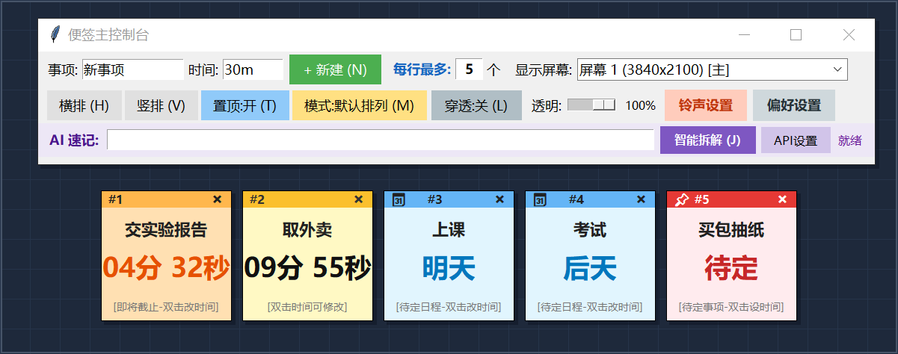
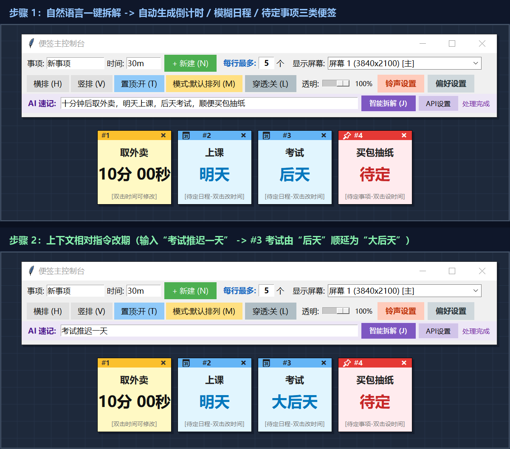
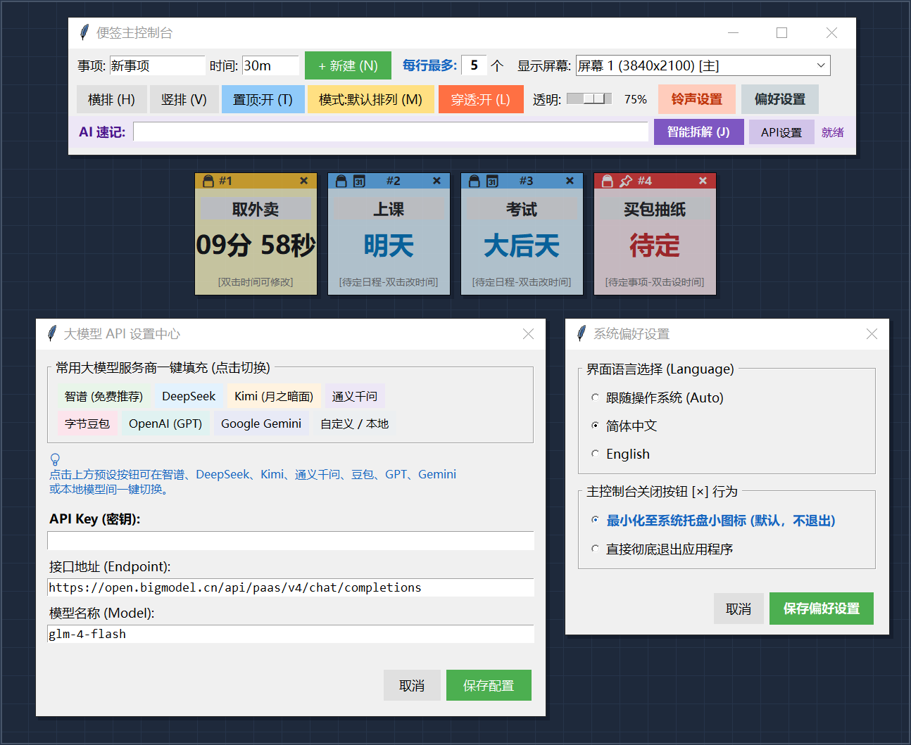
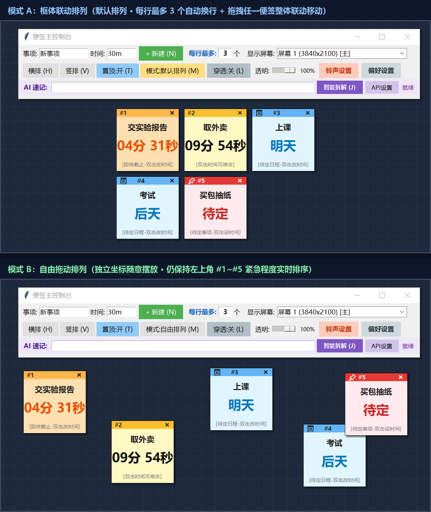
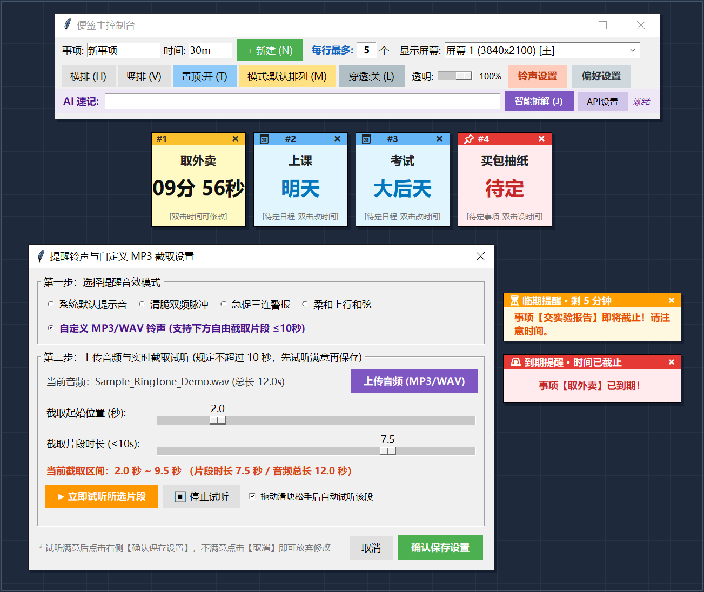

[简体中文](README.md) | [English](README_EN.md)

# StickyNotes_AI (v3.3) —— 智能方形桌面倒计时便签

一款基于 Python (`Tkinter` + Win32 API) 开发的轻量级 Windows 桌面方形倒计时便签与 AI 自然语言日程助手。支持自然语言一键拆解与上下文改期、三阶紧急度自动排序、框体联动/自由排列双模式、物理级鼠标点击穿透、多显示器逐屏 DPI 适配、自定义 MP3/WAV 铃声 ≤10 秒精准裁剪，以及提前 5 分钟 Toast 预警。

> **使用方式分流**：
> - **普通用户（开箱即用）**：前往 GitHub **Releases** 页面下载 `StickyNotes_AI_v3.3.zip`，解压后直接双击 **`StickyNotes_AI.exe`** 即可使用（压缩包内附中英双语 Word 说明书与 `sample_tasks.txt` 测试示例，无需安装 Python）。
> - **开发者（源码运行与二次开发）**：克隆本代码库后安装依赖运行 `python src/square_notes.py`，详细扩展与打包说明请参阅 [中英双语二次开发手册 (DEV_GUIDE.md)](docs/DEV_GUIDE.md)。



---

## 目录

- [核心功能亮点](#核心功能亮点)
- [快速开始（普通用户 vs 开发者）](#快速开始普通用户-vs-开发者)
- [AI 自然语言任务拆解实战](#ai-自然语言任务拆解实战)
- [全部核心功能详解](#全部核心功能详解)
  - [1. 四色卡片状态与三阶自动排序](#1-四色卡片状态与三阶自动排序)
  - [2. 多模型 AI 接口配置](#2-多模型-ai-接口配置)
  - [3. 两种排列模式与自动换行](#3-两种排列模式与自动换行)
  - [4. 多显示器识别与跨屏切换](#4-多显示器识别与跨屏切换)
  - [5. 透明度调节与鼠标点击穿透（开启与恢复方法）](#5-透明度调节与鼠标点击穿透开启与恢复方法)
  - [6. 自定义 MP3 裁剪与提前 5 分钟预警](#6-自定义-mp3-裁剪与提前-5-分钟预警)
  - [7. 系统托盘、偏好设置与单实例唤醒](#7-系统托盘偏好设置与单实例唤醒)
  - [8. 快捷键与鼠标操作一览表](#8-快捷键与鼠标操作一览表)
- [工程目录与本地数据存储](#工程目录与本地数据存储)
- [常见问题排查 (FAQ)](#常见问题排查-faq)

---

## 核心功能亮点

- **方形高颜值四色状态卡片**：`175×175` 像素无边框置顶卡片，自动按状态切换**暖黄常规、橙色临期（≤5分钟）、深红已到期、浅蓝模糊日程（🗓️）、淡红待定事项（📌）**五套视觉配色。
- **三阶紧急度实时排序**：每秒自动刷新倒计时并依据 `(优先级层级, 剩余秒数, 创建序号)` 排序，最紧迫事项永远排在 `#1`。
- **AI 速记拆解与上下文改期**：内置智谱 GLM-4-Flash（免费推荐）、DeepSeek、Kimi、通义千问、豆包、OpenAI、Google Gemini 与 Ollama 本地模型 8 大一键预设；一句口语可同时拆解多类任务，并支持「考试推迟一天」等相对修改。
- **双排列模式 + 边界防溢出折行**：支持「框体联动默认排列」与「自由拖动排列」一键切换，结合 `每行最多 N 个` 与屏幕工作区边界（避开任务栏）自动换行/换列。
- **物理级鼠标点击穿透**：通过 Win32 `WS_EX_TRANSPARENT | WS_EX_LAYERED` 实现真正穿透，悬浮在游戏、代码或文档上方时完全不遮挡鼠标点击与滚轮操作。
- **自定义 MP3/WAV 裁剪 + 5 分钟预警**：支持本地音频 0.1 秒精度截取 ≤10 秒片段并自动试听，剩余 5 分钟与归零时在屏幕右下角弹出可堆叠 Toast 通知。
- **中英双语热切换与单实例托盘**：支持跟随系统 / 简体中文 / English 实时切换并自适应窗口宽度，支持最小化至系统托盘及 TCP `58763` 端口单实例唤醒。

---

## 快速开始（普通用户 vs 开发者）

### 普通用户：下载 Release 压缩包点击 exe 即用
1. 从 GitHub Releases 下载并解压 `StickyNotes_AI_v3.3.zip`。
2. 文件夹内包含：
   - `StickyNotes_AI.exe`：绿色免安装主程序，双击即可运行；
   - `USER_MANUAL_CN.docx` / `USER_MANUAL_EN.docx`：中英双语完整 Word 说明书；
   - `sample_tasks.txt`：可直接复制测试的 AI 速记示例文本。
3. 首次运行后，所有便签与配置自动保存在程序同级 `notes_data/notes_state.json` 中。

### 开发者：克隆代码库与源码运行 / 打包
要求 **Windows 10 / 11** 与 **Python 3.10+**：

```bash
# 1. 克隆仓库
git clone https://github.com/your-username/StickyNotes_AI.git
cd StickyNotes_AI

# 2. 安装依赖
pip install -r requirements.txt

# 3. 源码启动
python src/square_notes.py

# 4. 构建独立发布压缩目录（输出至 dist/StickyNotes_AI_v3.3/）
python build.py
```

详细架构、扩展接口与自定义图标指南请查阅 [docs/DEV_GUIDE.md](docs/DEV_GUIDE.md)。

---

## AI 自然语言任务拆解实战

您可以直接复制 [`examples/sample_tasks.txt`](examples/sample_tasks.txt) 中的示例粘贴到主控制台底部的紫色 **`AI 速记`** 输入框（首次使用请先点击 `API设置` 配置密钥或连接本地 Ollama）：



以 `sample_tasks.txt` 第一组综合文本为例：

1. **输入第一句**：
   ```text
   十分钟后取外卖，明天上课，后天考试，顺便买包抽纸
   ```
   点击 **`智能拆解 (J)`**（或按 `Enter`），程序结合当前系统时间自动拆解为 4 张不同类型便签：

   | 原始片段 | AI 判定 `action` | `time_mode` / `time_val` | 生成卡片效果 |
   | :--- | :--- | :--- | :--- |
   | 十分钟后取外卖 | `create`（新建） | `timer` / `10m` | `#1` **取外卖** · `10分 00秒`（暖黄常规倒计时） |
   | 明天上课 | `create`（新建） | `fuzzy` / `明天` | `🗓️ #2` **上课** · `明天`（浅蓝模糊日程） |
   | 后天考试 | `create`（新建） | `fuzzy` / `后天` | `🗓️ #3` **考试** · `后天`（浅蓝模糊日程） |
   | 顺便买包抽纸 | `create`（新建） | `pending` / `待定` | `📌 #4` **买包抽纸** · `待定`（淡红待定事项） |

2. **输入第二句进行上下文改期**：
   ```text
   考试推迟一天
   ```
   程序自动匹配桌面上的 `#3 考试`，将其目标日期顺延 1 天，卡片标签实时从 **`后天`** 刷新为 **`大后天`**。

> **手动快速新建技巧**：顶部「时间」框同样支持中文数字与口语，如 `一刻钟`、`半小时`、`一个半小时`、`30m`、`明天下午`、`待定`；**鼠标左键双击**任意便签中央的时间区域可随时修改时间或一键设为待定。

---

## 全部核心功能详解

### 1. 四色卡片状态与三阶自动排序
- **第一梯队（精确倒计时）**：剩余 `> 5 分钟` 为暖黄色（`#FFF9C4`）；进入 `≤ 300 秒` 自动转为橙黄色（`#FFE0B2`）临期预警；倒计时归零后保持深粉红（`#FFCDD2`）提示已到期。
- **第二梯队（模糊日程 `🗓️`）**：浅蓝色（`#E1F5FE`），依据日期偏移与早/中/午/晚时段权重排序，并在跨过午夜后自动随系统日期刷新标签（`后天 → 明天 → 今天 → 昨天(已过)`）。
- **第三梯队（待定事项 `📌`）**：淡红色（`#FFEBEE`），固定垫底方便您专注于紧迫倒计时。

### 2. 多模型 AI 接口配置
点击 `API设置` 打开 **大模型 API 设置中心**，支持 OpenAI 兼容协议的 8 大预设一键切换，并内置**国内外直连 / 系统代理自动回退机制**：

| 预设服务商 | 默认 Endpoint | 默认模型 | 备注 |
| :--- | :--- | :--- | :--- |
| **智谱 (免费推荐)** | `https://open.bigmodel.cn/api/paas/v4/chat/completions` | `glm-4-flash` | 免费且国内直连延迟极低 |
| **DeepSeek** | `https://api.deepseek.com/chat/completions` | `deepseek-chat` | 推理准确率极高，国内直连 |
| **Kimi (月之暗面)** | `https://api.moonshot.cn/v1/chat/completions` | `moonshot-v1-8k` | 长文本与口语拆解出色 |
| **通义千问** | `https://dashscope.aliyuncs.com/compatible-mode/v1/chat/completions` | `qwen-turbo` | 阿里云百炼兼容模式 |
| **字节豆包** | `https://ark.cn-beijing.volces.com/api/v3/chat/completions` | `ep-请替换为火山接入点ID` | 模型栏须填火山引擎 `ep-xxxx` 接入点 ID |
| **OpenAI (GPT)** | `https://api.openai.com/v1/chat/completions` | `gpt-4o-mini` | 支持系统代理自动回退或中转地址 |
| **Google Gemini** | `https://generativelanguage.googleapis.com/v1beta/openai/chat/completions` | `gemini-2.5-flash` | 官方 OpenAI 兼容地址，支持代理回退 |
| **自定义 / 本地** | `http://localhost:11434/v1/chat/completions` | `qwen2.5:7b` | 支持 Ollama / OneAPI；本地地址免填 Key |



### 3. 两种排列模式与自动换行


- **默认排列（框体联动）**：按住任意一张便签顶栏彩色区域拖动，整个矩阵同步移动；支持 `横排 (H)` / `竖排 (V)`，并在达到 `每行最多` 设定值或屏幕工作区边缘时自动换行/换列。
- **自由排列（独立摆放）**：切换为 `模式:自由排列 (M)` 后，每张便签可拖至桌面任意位置并单独记忆坐标，左上角 `#1~#N` 排序号依然实时动态更新；按 `M` 切回默认排列即可瞬间归位。

### 4. 多显示器识别与跨屏切换
基于 Win32 `EnumDisplayMonitors` 与逐屏幕 DPI 感知（`SetProcessDpiAwareness(2)`），在控制栏 `显示屏幕` 下拉框选择目标显示器，即可将全部便签投送至指定屏幕并按其分辨率自动折行。

### 5. 透明度调节与鼠标点击穿透（开启与恢复方法）
- **透明度调节**：拖动 `透明` 滑块在 `20% ~ 100%` 之间无级调节，或按 `O` / `Ctrl+O` 在 `100% → 80% → 60% → 40%` 间快速循环。
- **开启鼠标点击穿透**：点击 `穿透:关 (L)` 或按 `L` / `Ctrl+L`，按钮变为橙色 `穿透:开 (L)`，卡片左上角显示 `🔒`。此时便签注入 `WS_EX_TRANSPARENT | WS_EX_LAYERED`，鼠标点击与滚轮全部穿透至底层应用。
- **如何恢复/解除鼠标点击穿透（3 种方式）**：
  1. 点击主控制台第二行的橙色 **`穿透:开 (L)`** 按钮（控制台自身永不穿透）；
  2. 激活主控制台窗口后按键盘 **`L`** 或 **`Ctrl+L`**；
  3. 当控制台隐藏时，**右键屏幕右下角系统托盘图标 -> 切换鼠标穿透**。

### 6. 自定义 MP3 裁剪与提前 5 分钟预警


- **5 种铃声模式**：内置 4 种合成提示音 + **自定义 MP3/WAV 铃声**；支持 0.1 秒精度滑块截取任意 `≤ 10.0 秒` 片段并支持松手自动试听，底层通过 8.3 短路径调用 Windows MCI 兼容中文路径，保存时自动备份至 `notes_data/custom_ringtone.<ext>`。
- **双级 Toast 预警**：剩余时间首次进入 `≤ 300 秒` 弹出橙色「⏳ 临期提醒 · 剩 5 分钟」弹窗，归零弹出红色「🚨 到期提醒 · 时间已截止」弹窗；支持多条堆叠，10 秒后自动关闭并停止铃声，也可左键单击弹窗立即关闭静音。

### 7. 系统托盘、偏好设置与单实例唤醒
- **系统托盘**：双击托盘图标显隐控制台；右键支持新建便签、批量显隐所有便签、切换穿透、切换横/竖排、打开铃声/API/偏好设置及彻底退出。
- **偏好设置**：支持 `跟随系统 / 简体中文 / English` 实时切换，以及自定义点击主控制台 `[×]` 是「最小化至系统托盘（默认）」还是「直接彻底退出」。
- **单实例唤醒**：绑定本地 `127.0.0.1:58763` 端口，重复启动软件时自动唤醒已隐藏的主控制台。

### 8. 快捷键与鼠标操作一览表

| 按键 / 鼠标操作 | 功能说明 | 按键 / 鼠标操作 | 功能说明 |
| :--- | :--- | :--- | :--- |
| `N` / `Ctrl+N` | 新建便签 | `L` / `Ctrl+L` | 开启 / 解除鼠标点击穿透 |
| `J` / `Ctrl+J` | AI 智能拆解 | `O` / `Ctrl+O` | 循环透明度 (`100→80→60→40%`) |
| `H` / `Ctrl+H` | 切换横排布局 | `Enter` | 事项/AI 框快速提交 |
| `V` / `Ctrl+V` | 切换竖排布局 | **左键双击时间** | 弹出修改时间 / 设为待定弹窗 |
| `T` / `Ctrl+T` | 切换窗口置顶 | **左键拖拽顶栏** | 联动移动矩阵 / 自由单卡拖动 |
| `M` / `Ctrl+M` | 切换默认 / 自由排列 | **输入框右键** | 剪切 / 复制 / 粘贴 / 全选菜单 |

---

## 工程目录与本地数据存储

```text
StickyNotes_AI_Release/
├── assets/
│   └── app.ico                    # 应用窗口与系统托盘默认图标
├── src/
│   └── square_notes.py            # 核心源码（兼容源码与 PyInstaller _MEIPASS）
├── docs/
│   ├── images/                    # 界面说明截图 (01~05)
│   ├── DEV_GUIDE.md               # 中英双语二次开发手册
│   ├── USER_MANUAL_CN.docx        # 中文完整图文 Word 说明书
│   └── USER_MANUAL_EN.docx        # 英文完整图文 Word 说明书
├── examples/
│   └── sample_tasks.txt           # 公开 AI 速记测试用例
├── build.py                       # 一键构建可分发的 dist/StickyNotes_AI_v3.3/ 目录
├── requirements.txt
├── README.md
└── README_EN.md
```

- **本地存储与备份**：程序运行数据自动保存在程序同级 `notes_data/notes_state.json`（含便签内容、目标时间戳 `target_timestamp`、布局偏好、API 与铃声相对路径）。迁移或备份只需复制整个 `notes_data/` 文件夹即可。

---

## 常见问题排查 (FAQ)

1. **开启鼠标穿透后点不到便签？**
   点击主控制台 **`穿透:开 (L)`** 按钮、聚焦控制台按 **`L`**，或右键右下角系统托盘图标选择「切换鼠标穿透」即可立即恢复。
2. **点 `[×]` 关闭控制台后怎么找回？**
   默认设置下会最小化到系统托盘后台继续倒计时。双击托盘图标或再次双击 `StickyNotes_AI.exe` 即可唤醒控制台。
3. **AI 拆解报 HTTP 401 或网络超时？**
   检查 `API设置` 中的 Key 是否有效（字节豆包模型栏须填写 `ep-xxxx` 接入点 ID）；国内接口已默认优先直连绕过本地代理。
4. **部分音频文件提示无法解码？**
   Windows MCI 仅支持标准 MP3 与 PCM WAV 格式，加密音乐格式请先转换为标准 MP3 或 WAV。

---

## 开源协议

本项目采用 [MIT License](LICENSE) 开源协议，允许免费下载、个人使用、修改与分发。

## 开发说明

本项目在设计与开发过程中使用了 AI 辅助编程工具提升迭代效率，所有功能与发布版本均经过人工实测验证。
