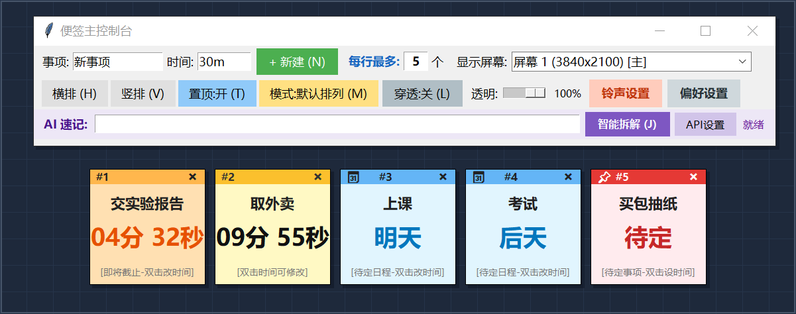
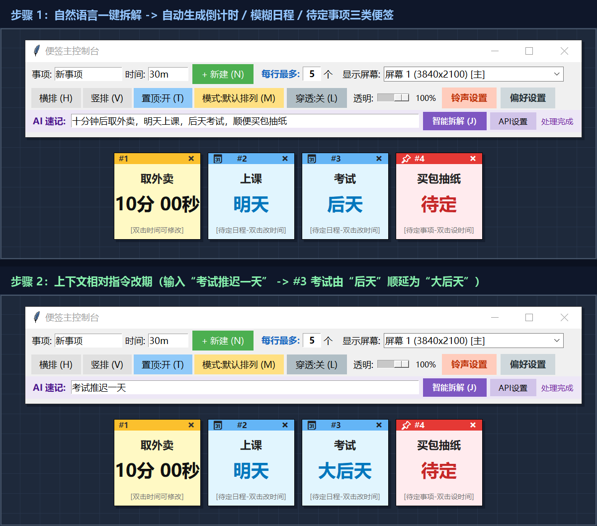
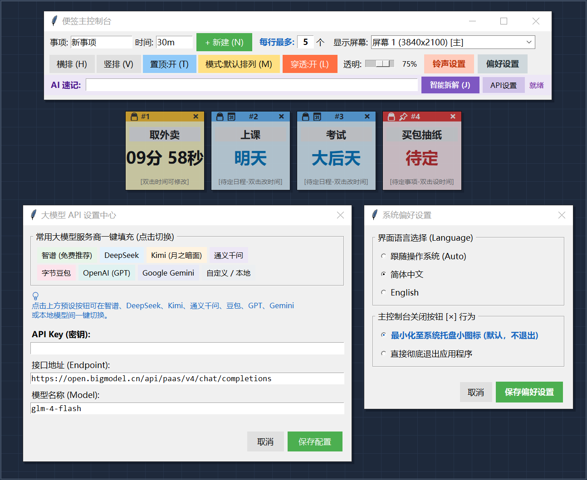
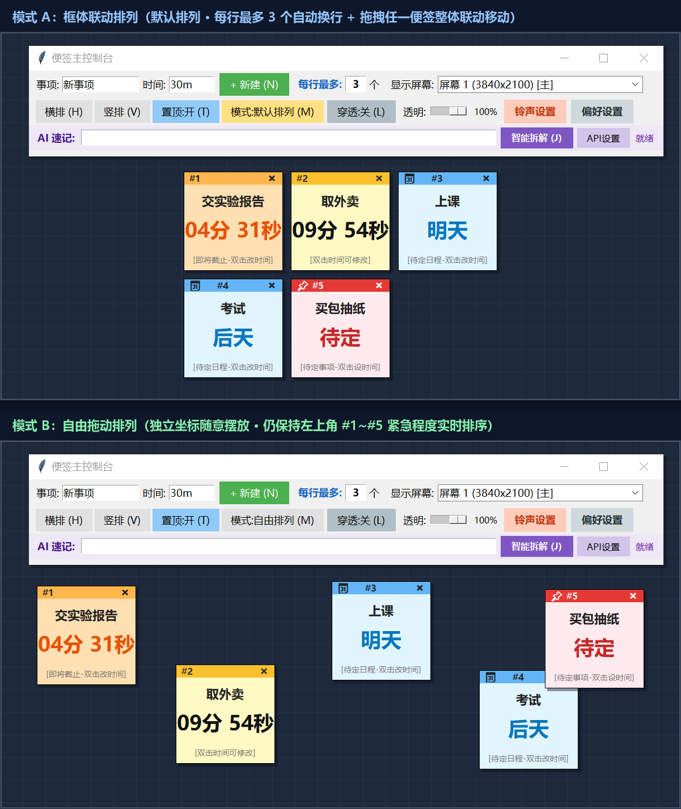
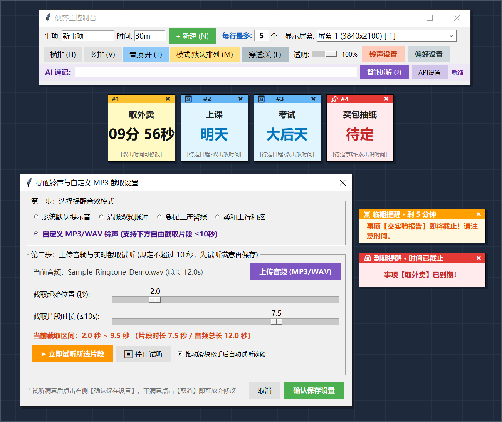

[简体中文](README.md) | [English](README_EN.md)

# StickyNotes_AI (v3.3) — Smart Square Desktop Countdown Sticky Notes

A lightweight Windows desktop countdown sticky notes & AI natural-language scheduler built with Python (`Tkinter` + Win32 API). It features one-click AI task parsing and relative rescheduling, 3-tier urgency auto-sorting, Grid/Free dual layout modes, hardware-level mouse click-through, per-monitor DPI scaling, custom MP3/WAV trimming (≤10s), and 5-minute advance Toast alerts.

> **Quick Onboarding**:
> - **End Users (Ready to Use)**: Download `StickyNotes_AI_v3.3.zip` from GitHub **Releases**, unzip it, and double-click **`StickyNotes_AI.exe`** (includes bilingual Word manuals and `sample_tasks.txt`; no Python installation required).
> - **Developers (Source & Customization)**: Clone this repository, install dependencies, and run `python src/square_notes.py`. See the [Bilingual Developer Guide (DEV_GUIDE.md)](docs/DEV_GUIDE.md) for architecture and packaging details.



---

## Table of Contents

- [Key Highlights](#key-highlights)
- [Quick Start (End Users vs Developers)](#quick-start-end-users-vs-developers)
- [AI Natural Language Task Parsing Walkthrough](#ai-natural-language-task-parsing-walkthrough)
- [Detailed Feature Guide](#detailed-feature-guide)
  - [1. Color-Coded States & 3-Tier Auto-Sorting](#1-color-coded-states--3-tier-auto-sorting)
  - [2. Multi-Model AI API Configuration](#2-multi-model-ai-api-configuration)
  - [3. Grid vs Free Layout Modes & Auto-Wrapping](#3-grid-vs-free-layout-modes--auto-wrapping)
  - [4. Multi-Monitor Detection & Cross-Screen Placement](#4-multi-monitor-detection--cross-screen-placement)
  - [5. Opacity Control & Mouse Click-Through (Enable & Restore)](#5-opacity-control--mouse-click-through-enable--restore)
  - [6. Custom MP3/WAV Trimming & 5-Min Advance Alert](#6-custom-mp3wav-trimming--5-min-advance-alert)
  - [7. System Tray, Preferences & Single-Instance Wakeup](#7-system-tray-preferences--single-instance-wakeup)
  - [8. Keyboard Shortcuts & Mouse Controls](#8-keyboard-shortcuts--mouse-controls)
- [Project Structure & Local Data Backup](#project-structure--local-data-backup)
- [Troubleshooting (FAQ)](#troubleshooting-faq)

---

## Key Highlights

- **175×175 Square Status-Aware Cards**: Borderless always-on-top cards that automatically switch among **Warm Yellow (Normal), Orange (≤5m Warning), Crimson (Expired), Sky Blue (Fuzzy Schedule 🗓️), and Rose Red (Pending 📌)**.
- **3-Tier Urgency Auto-Sorting**: Refreshes every second and sorts by `(tier, remaining_seconds, note_id)` so the most urgent countdown always stays at `#1`.
- **AI Memo Parsing & Context Rescheduling**: Built-in presets for 8 popular providers (Zhipu GLM-4-Flash free tier, DeepSeek, Kimi, Qwen, Doubao, OpenAI, Google Gemini, and local Ollama). Turns a single sentence into multiple categorized cards and understands relative updates like `"Postpone exam by 1 day"`.
- **Dual Layout Modes + Smart Wrapping**: Switch between linked Grid Mode (drag any card header to move the whole matrix) and Free Mode (drag each card independently anywhere on screen), with `Max/Row` and work-area boundary wrapping.
- **True Mouse Click-Through**: Uses Win32 `WS_EX_TRANSPARENT | WS_EX_LAYERED` so clicks and scroll events pass straight through to underlying games, editors, or browsers.
- **Custom MP3/WAV Trimming + 5-Min Toast Alerts**: 4 built-in synthesized alerts plus local MP3/WAV upload with 0.1s-precision `≤10s` clip trimming and stacked bottom-right Toast notifications.
- **Bilingual Live Switching & Single-Instance Tray**: Instant `Auto / 简体中文 / English` UI switching with dynamic console auto-fit, system tray minimization, and TCP `58763` single-instance wakeup.

---

## Quick Start (End Users vs Developers)

### End Users: Download Release ZIP & Run EXE
1. Download and extract `StickyNotes_AI_v3.3.zip` from GitHub Releases.
2. Inside the folder you will find:
   - `StickyNotes_AI.exe`: Portable standalone executable — double-click to launch;
   - `USER_MANUAL_CN.docx` / `USER_MANUAL_EN.docx`: Full illustrated Chinese & English Word manuals;
   - `sample_tasks.txt`: Ready-to-copy natural-language test prompts.
3. All notes and settings are stored cleanly in `notes_data/notes_state.json` beside the executable.

### Developers: Clone & Run from Source / Build
Requires **Windows 10 / 11** and **Python 3.10+**:

```bash
# 1. Clone repository
git clone https://github.com/your-username/StickyNotes_AI.git
cd StickyNotes_AI

# 2. Install dependencies
pip install -r requirements.txt

# 3. Launch from source
python src/square_notes.py

# 4. Build release bundle into dist/StickyNotes_AI_v3.3/
python build.py
```

See [docs/DEV_GUIDE.md](docs/DEV_GUIDE.md) for architecture details, extension points, icon customization, and build instructions.

---

## AI Natural Language Task Parsing Walkthrough

Copy any sample line from [`examples/sample_tasks.txt`](examples/sample_tasks.txt) into the purple **`AI Memo`** box at the bottom of the console (configure your key or local Ollama endpoint under `API Config` first):



1. **First input** (from `sample_tasks.txt`):
   ```text
   十分钟后取外卖，明天上课，后天考试，顺便买包抽纸
   ```
   (or in English: `Take out food in 10m, class tomorrow, exam in 2 days, buy tissues`)
   Click **`Parse (J)`** or press `Enter` to generate 4 cards automatically:

   | Clause | AI `action` | `time_mode` / `time_val` | Resulting Card |
   | :--- | :--- | :--- | :--- |
   | Take out food in 10m | `create` | `timer` / `10m` | `#1` Countdown (`10m 00s`, Warm Yellow) |
   | Class tomorrow | `create` | `fuzzy` / `Tomorrow` | `🗓️ #2` Fuzzy Schedule (`Tomorrow`, Sky Blue) |
   | Exam in 2 days | `create` | `fuzzy` / `In 2 days` | `🗓️ #3` Fuzzy Schedule (`In 2 days`, Sky Blue) |
   | Buy tissues | `create` | `pending` / `Pending` | `📌 #4` Pending To-Do (`Pending`, Rose Red) |

2. **Follow-up relative update**:
   ```text
   考试推迟一天  /  Postpone exam by 1 day
   ```
   The parser matches the existing `#3` exam card and shifts its target date by `+1 day` automatically.

> **Manual Quick Input Tip**: The top `Time` box accepts durations (`30m`, `1h30m`, `5m10s`, `2d`, or plain numbers in minutes), Chinese expressions (`一刻钟`, `一个半小时`), fuzzy dates (`tomorrow`, `明天下午`), or `pending`/`待定`. **Double-click** any card's time label to edit it anytime.

---

## Detailed Feature Guide

### 1. Color-Coded States & 3-Tier Auto-Sorting
- **Tier 0 (Exact Countdown)**: Warm yellow (`#FFF9C4`) when `> 5m`; shifts to orange (`#FFE0B2`) warning at `≤ 300s`; turns crimson (`#FFCDD2`) at `0s`.
- **Tier 1 (Fuzzy Schedule `🗓️`)**: Sky blue (`#E1F5FE`), sorted by day offset and time-of-day weight, automatically evolving across midnight (`In 2 days → Tomorrow → Today → Yesterday`).
- **Tier 2 (Pending Tasks `📌`)**: Rose red (`#FFEBEE`), always sorted at the end so urgent timers stay visible first.

### 2. Multi-Model AI API Configuration
Click `API Config` to open **AI Model API Config**, featuring 8 one-click OpenAI-compatible presets with automatic direct/system-proxy fallback:

| Preset | Default Endpoint | Default Model | Notes |
| :--- | :--- | :--- | :--- |
| **Zhipu AI (Free)** | `https://open.bigmodel.cn/api/paas/v4/chat/completions` | `glm-4-flash` | Free tier available |
| **DeepSeek** | `https://api.deepseek.com/chat/completions` | `deepseek-chat` | Strong reasoning |
| **Kimi** | `https://api.moonshot.cn/v1/chat/completions` | `moonshot-v1-8k` | Great bilingual parsing |
| **Qwen (Alibaba)** | `https://dashscope.aliyuncs.com/compatible-mode/v1/chat/completions` | `qwen-turbo` | DashScope compatible mode |
| **Doubao** | `https://ark.cn-beijing.volces.com/api/v3/chat/completions` | `ep-your-endpoint-id` | Requires Volcengine `ep-xxxx` endpoint ID |
| **OpenAI (GPT)** | `https://api.openai.com/v1/chat/completions` | `gpt-4o-mini` | Auto system proxy fallback |
| **Google Gemini** | `https://generativelanguage.googleapis.com/v1beta/openai/chat/completions` | `gemini-2.5-flash` | Official OpenAI-compatible endpoint |
| **Custom / Local** | `http://localhost:11434/v1/chat/completions` | `qwen2.5:7b` | Ollama / OneAPI; no API key required for localhost |



### 3. Grid vs Free Layout Modes & Auto-Wrapping


- **Mode:Grid (Linked Matrix)**: Dragging any card's top title bar moves the entire note matrix together. Supports `Horizontal (H)` / `Vertical (V)` directions and wraps automatically when reaching `Max/Row` (set `0` for unlimited) or monitor work-area boundaries.
- **Mode:Free (Independent Placement)**: Each card can be dragged to any desktop coordinate independently while keeping real-time `#1~#N` urgency badges updated. Press `M` anytime to snap back into the sorted grid.

### 4. Multi-Monitor Detection & Cross-Screen Placement
Powered by Win32 `EnumDisplayMonitors` and `SetProcessDpiAwareness(2)`, the `Screen` dropdown lists all active monitors with work-area resolutions and `[Primary]` tags so you can move all notes to any display in one click.

### 5. Opacity Control & Mouse Click-Through (Enable & Restore)
- **Opacity**: Drag the `Opacity` slider (`20% ~ 100%`) or press `O` / `Ctrl+O` to cycle through `100% → 80% → 60% → 40%`.
- **Enable Click-Through**: Click `Click-Thru:Off (L)` or press `L` / `Ctrl+L`. Cards show a `🔒` icon and receive `WS_EX_TRANSPARENT | WS_EX_LAYERED`, letting all clicks and scrolling pass through to windows underneath.
- **How to Disable / Restore Click-Through (3 Ways)**:
  1. Click the orange **`Click-Thru:On (L)`** button on the main console (the console itself never becomes click-through);
  2. Focus the main console window and press **`L`** or **`Ctrl+L`**;
  3. If the console is hidden, **right-click the system tray icon -> Toggle Click-Through**.

### 6. Custom MP3/WAV Trimming & 5-Min Advance Alert


- **5 Alert Modes**: 4 built-in beeps/chimes plus **Custom MP3/WAV Audio** with `0.1s` sliders to trim any `≤ 10.0s` segment (supports auto-preview on slider release, 8.3 short paths for Unicode filenames, and automatic local copy to `notes_data/custom_ringtone.<ext>`).
- **Dual Toast Popups**: Triggers an amber `5 Min Left` Toast at `≤ 300s` and a crimson `Time's Up` Toast at `0s` in the primary monitor's bottom-right corner. Popups stack cleanly and auto-close (and stop audio) after 10 seconds or immediately upon click.

### 7. System Tray, Preferences & Single-Instance Wakeup
- **System Tray**: Double-click the tray icon to toggle console visibility; right-click for quick actions (New Note, Show/Hide All Notes, Toggle Click-Through, Toggle Layout, Ringtone/API/Preferences, Exit).
- **Preferences**: Switch `Auto / Simplified Chinese / English` dynamically and choose whether clicking `[×]` minimizes to tray (default) or exits completely.
- **Single-Instance Wakeup**: Binds TCP `127.0.0.1:58763`; launching a second instance sends `SHOW` to restore the existing console window.

### 8. Keyboard Shortcuts & Mouse Controls

| Shortcut / Mouse Action | Function | Shortcut / Mouse Action | Function |
| :--- | :--- | :--- | :--- |
| `N` / `Ctrl+N` | New Sticky Note | `L` / `Ctrl+L` | Toggle Click-Through |
| `J` / `Ctrl+J` | AI Parse Memo | `O` / `Ctrl+O` | Cycle Opacity (`100→80→60→40%`) |
| `H` / `Ctrl+H` | Horizontal Layout | `Enter` | Submit New Note / AI Parse / Edit Time |
| `V` / `Ctrl+V` | Vertical Layout | **Double-click Time** | Open Time / Pending Edit Dialog |
| `T` / `Ctrl+T` | Toggle Always-on-Top | **Drag Card Header** | Move Matrix (Grid) or Single Card (Free) |
| `M` / `Ctrl+M` | Toggle Grid / Free Mode | **Right-click Entry** | Cut / Copy / Paste / Select All Menu |

---

## Project Structure & Local Data Backup

```text
StickyNotes_AI_Release/
├── assets/
│   └── app.ico                    # Application window & system tray icon
├── src/
│   └── square_notes.py            # Clean release source (supports _MEIPASS resources)
├── docs/
│   ├── images/                    # Illustrated screenshots (01~05)
│   ├── DEV_GUIDE.md               # Bilingual Developer Guide
│   ├── USER_MANUAL_CN.docx        # Illustrated Chinese Word Manual
│   └── USER_MANUAL_EN.docx        # Illustrated English Word Manual
├── examples/
│   └── sample_tasks.txt           # Ready-to-copy AI test prompts
├── build.py                       # Bundles dist/StickyNotes_AI_v3.3/ release folder
├── requirements.txt
├── README.md
└── README_EN.md
```

- **Backup & Migration**: All notes, timestamps, and settings reside in `notes_data/notes_state.json`. Back up or copy the entire `notes_data/` folder to migrate seamlessly across PCs.

---

## Troubleshooting (FAQ)

1. **Cannot click cards after enabling Click-Through?**
   Click **`Click-Thru:On (L)`** on the main console, focus the console and press **`L`**, or right-click the system tray icon -> **Toggle Click-Through**.
2. **Main console disappeared after clicking `[×]`?**
   By default it minimizes to the system tray so timers keep running. Double-click the tray icon or run `StickyNotes_AI.exe` again to wake it up.
3. **HTTP 401 or timeout during AI parsing?**
   Verify your API key and model name (Volcengine Doubao requires your `ep-xxxx` endpoint ID). Domestic Chinese endpoints try direct connection before falling back to system proxy.
4. **Audio file failed to decode?**
   Windows MCI supports standard MP3 and PCM WAV files; encrypted formats (`.ncm`/`.qmc`) must be converted to standard MP3/WAV first.

---

## License

Released under the [MIT License](LICENSE). Free to download, use, modify, and distribute.

## Development Note

This project was built with the assistance of AI coding tools to accelerate iteration. All features and release builds have been manually tested and verified.
